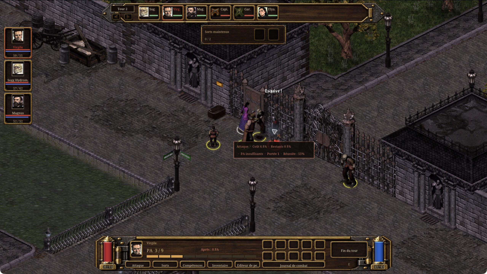
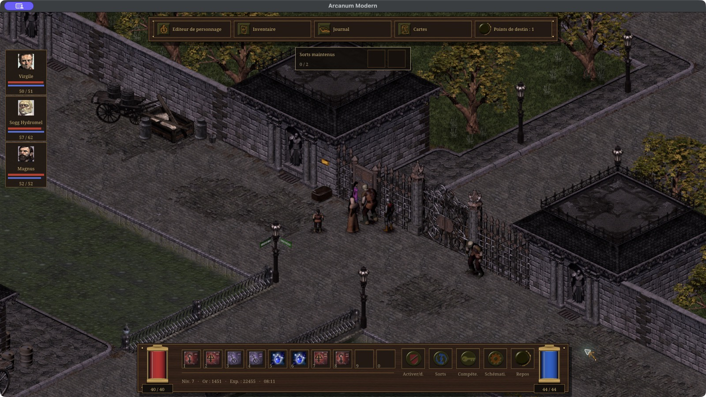
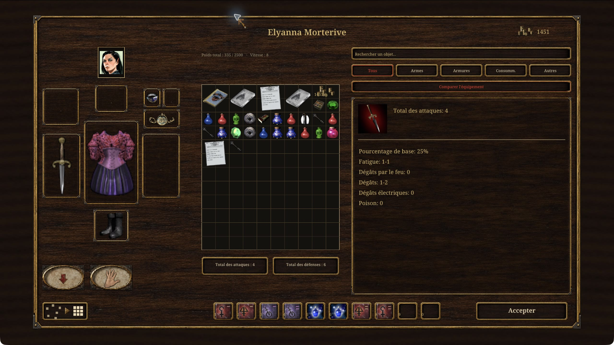
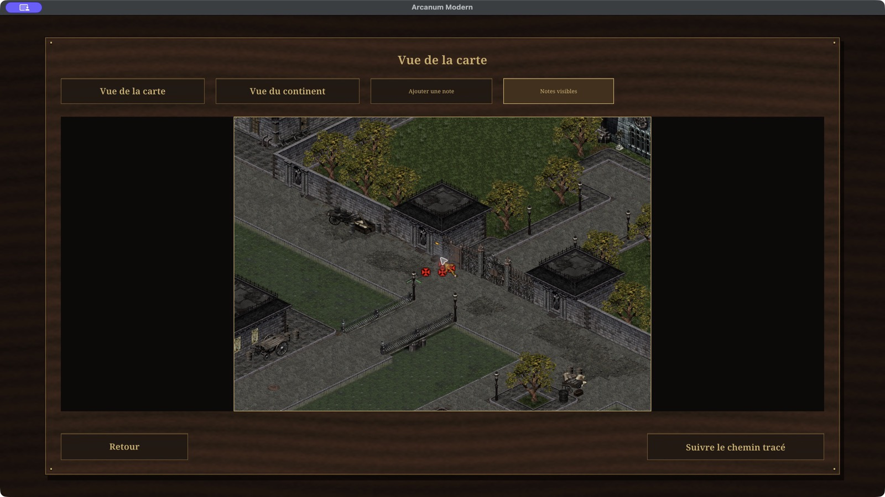

# Arcanum Renaissance

An experimental, unofficial modernization of **Arcanum: Of Steamworks and
Magick Obscura**, featuring a redesigned interface and **BG3-inspired tactical
combat**, based on [Arcanum Community Edition](https://github.com/alexbatalov/arcanum-ce).

## Installation

### Windows

**[Download the Windows setup](https://github.com/cdomergue/arcanum-modern/releases/latest/download/ArcanumModern-windows-x64-setup.exe).**

You need your own copy of the original game:
[buy Arcanum on GOG](https://www.gog.com/en/game/arcanum_of_steamworks_and_magick_obscura).

1. Install your own copy of **Arcanum**, updated to **1.0.7.4**.
2. Open the downloaded setup and select the folder where Arcanum is installed.
3. Launch the game using the shortcut on your desktop or in the Start menu.

The setup installs the mod for you and keeps your original game, saves and
settings. You do not need to compile anything or install development tools.
Close the game before installing or updating, and use a folder you can write to.

A Windows ZIP is also available in [Releases](https://github.com/cdomergue/arcanum-modern/releases/latest) for manual
installation: extract it into your Arcanum folder, then open **Play Arcanum Renaissance.bat**.

### macOS

Download the macOS ZIP from [Releases](https://github.com/cdomergue/arcanum-modern/releases/latest), extract it into
your Arcanum game folder, then open **Arcanum Modern.app** beside the game files.
This version requires an Apple Silicon Mac (M1 or newer) with macOS 11 or later.

### Linux

Download the Linux x64 ZIP from [Releases](https://github.com/cdomergue/arcanum-modern/releases/latest) and extract it
into your Arcanum game folder. Run **Play Arcanum Renaissance.sh** from that folder.
If your file manager does not run shell scripts, open a terminal there and enter
`./"Play Arcanum Renaissance.sh"`.

### Game files and HD maps

**You must supply your own Arcanum 1.0.7.4 game files.** Release downloads contain
only the mod: no original game data, saves, personal settings or HD map cache.
**On first launch, the game prepares HD local maps automatically**, with a progress
bar, on Windows, macOS and Linux. No extra tools or downloads are needed. Allow
about **8 GB** for Arcanum and Vormantown, plus temporary working space; the time
needed depends on your machine and installed modules. Choose **Play now** to use
the original maps immediately. Preparation resumes at the next launch, keeping
completed tiles. A complete cache is reused on subsequent launches.

If preparation fails, note the error code shown on screen and check
`modern-ui/.map-work/generation.log` inside your game folder. You can still choose
**Play now** and use the original maps.

To compile the mod yourself, see the [build instructions](docs/development.md#build-from-source).
Back up your saved games before trying an experimental engine.

### Unofficial Arcanum Patch

For recognized original French game files, Renaissance offers an optional
**automatic UAP Base + Race Mod installation** at startup, with a Yes / No choice.
It downloads the UAP, prepares French text and verifies a separate backup of your
saved games before activation. **Existing campaigns may be incompatible.**
See [French UAP installation and backup restoration](docs/uap-fr.md) for details
and system requirements.

Renaissance supports the English **UAP 2.0.2**, including Race Mod, Beta Content,
the additional campaigns and optional data packs. Install the UAP and select its
options **before installing Renaissance**, then start a new game.

See [UAP installation and options](docs/uap.md) for the original executable's
optional patches, platform transfers and how the two interfaces interact.

## Features

- **BG3-inspired tactical combat:** take direct control of eligible companions
  and switch freely between allies with consecutive turns, each keeping their
  own remaining action points. Preview movement and actions, inspect costs and
  spell availability, and inspect actual attack rolls, hit chances and outcomes
  in a scrollable combat log. Turn-based combat is
  enabled by default. Initiative, action points, fatigue, damage and spell
  restrictions follow Arcanum's rules.
- **Native-resolution interface:** readable text and controls that keep their
  size while you zoom the world. The visual style uses wood, brass, parchment
  and the game's original artwork.
- **Redesigned screens:** HUD, party portraits, character sheet, inventory,
  trading, dialogue, journal, maps, spell and skill panels, save/load menus and
  display options.
- **Camera and display controls:** mouse-wheel zoom, keyboard camera movement,
  remappable keys, and windowed, desktop fullscreen and exclusive fullscreen
  modes. The world adapts to the window's aspect ratio.
- **Inventory tools:** search, categories, equipment comparison, item details,
  transfer shortcuts and editable quick slots with hover descriptions.
- **Integrated AID item descriptions:** French and English descriptions, quest
  and crafting tags, offerings, gifts, minimum strength and item effects in the
  Arcanum campaign. Unique items are resolved directly, including in existing
  saves; no map replacement or cache deletion is required. Magical properties
  remain hidden until identification. Details scroll in the inventory panel.
- **Companion grouping:** detach companions to position them independently, then
  regroup them from their portraits. They remain members of your party.
- **Rotating autosaves:** keep the three latest automatic saves before and after
  combat and before eligible area transitions, separately from manual saves.
- **Journal and exploration:** quest filters, search, favorites, quest tracking
  and personal map notes.
- **Automatically prepared HD local maps:** maps rendered from the installed game data,
  with exploration fog and separately drawn localized labels and
  markers. Zoom in or out, inspect planned routes and clear their waypoints.
  Original maps also support zoom when the detailed cache is absent.
- **Readable game text:** books, letters, newspapers, inscriptions, telegrams
  and floating dialogue use the installed game's content.
- **Original cinematics:** the integrated player reads the installed BIK videos
  directly on Windows, macOS and Linux, with their original audio and story
  triggers. No conversion, video download or extra preparation is required.
- **Optional unlimited companions:** disabled by default; recruitment conditions
  still apply.

Names, descriptions and most labels follow the language of your game files.
Additional interface text has partial French and English support. Western game
text is decoded as Windows-1252; other encodings need validation.

## Video

Here is a video in version 1.0.0: [https://www.youtube.com/watch?v=yj_ana898HA&t=5s](https://www.youtube.com/watch?v=v1U5BpJ3y8U)

## Screenshots

These screenshots use French game files. In your installation, game text follows
the language of your own copy of Arcanum; the mod does not require the French
version. Click an image to enlarge it.

**BG3-inspired tactical combat:** direct companion control, turn order and action points.

| Exploration | Inventory and equipment |
| --- | --- |
|  |  |

**HD local maps**, generated from your game files.

## Controls and gameplay

Change bindings in **Options → Key bindings**. AZERTY and QWERTY presets are
available.

| Action | Default |
| --- | --- |
| Inventory / journal / character sheet | I / J / C |
| Map | G |
| Spells / skills / schematics | M / K / T |
| Rest | R |
| Stealth / pickpocket | H / P |
| Toggle combat mode | Shift + Space |
| Attack a highlighted door, barrel or other scenery | Left-click in combat mode |
| End turn | E or Space |
| Move camera | WASD positions, ZQSD on AZERTY, or arrow keys |
| Zoom world | Mouse wheel over the world |
| Zoom local map | Mouse wheel over the map, or its − / + buttons |
| Use quick slot | 1–0 |
| Close panel or open pause menu | Escape |

Each controlled character has ten personal quick slots, stored with the saved game.
Hover an item, spell or skill in that character’s menus and press **1–0** to assign
a slot, or drag it onto the bar.
**Shift-click** transfers a whole stack. When exchanging items with a companion
or container, **Transfer all** moves the bag contents in the indicated direction;
equipped items stay in place and items that cannot be moved remain in their bag.
Drag the map to pan it. In the journal,
the **star** marks favorites and the **pin** tracks a quest.

On the local map, distant destinations automatically add intermediate waypoints
when a valid route fits within the six-point limit. Use the travel button to
start following the route. The line and destination marker show your planned
journey; clear it with the route cancel control. Drag to pan, and use the mouse
wheel or − / + buttons to zoom in or out.

Outside combat, the **`=` / `/`** control on a companion portrait toggles grouping.
Click a portrait to select and detach that companion, then click the ground to
move them, interact, use their skills, cast their spells or manage their inventory.
Click the portrait again, the **Player** button, or right-click the world to
return to your main character.
Conversations use the selected companion’s characteristics and skills; quest
progress remains shared with the main character. Grouping is saved with the game;
area transitions retain the game's normal party travel behavior.

The combat log retains up to 128 recent lines during the session and remains
available after combat. Scroll it with the wheel or its page buttons. Attack
entries show the resolved outcome and, when applicable, the actual roll and hit
chance. Rejected actions display feedback from the engine.

Turn-based combat is the default for fresh installations. Allies with consecutive
turns share a turn group: click an available portrait to choose who acts, then
switch back while they still have action points. A gold underline in the
initiative bar marks available allies. **End turn** finishes the selected
character; enemies act once the group has finished.

The camera pans smoothly to the active character, with a brief input guard to
prevent accidental actions. Selecting any other portrait centers the camera. A `~`
on an action cost marks an estimate; the engine determines the final cost.

## Preferences and saves

Paths are relative to the game folder:

| Path | Contents |
| --- | --- |
| `modern-ui/settings.ini` | Interface and gameplay preferences. |
| `modern-ui/graphics.ini` | Display mode and resolution. |
| `modern-ui/keys.ini` | Key bindings. |
| `modern-ui/notebook-*.txt` | Favorites, tracked quests and map notes per character. |
| `arcanum.cfg` | Engine and game settings. |
| `modules/<module>/Save/` | Saved games for that module. |

Automatic saves use dedicated slots and retain the three latest completed saves.
They run only when the character and game state permit saving; dialogue, combat,
menus and some transitions can defer or skip them. Manual saves remain separate.

Notebook files are independent of saves: loading an older save does not roll
back its notes. Keep both when moving your installation.

## Limitations

- The world uses the original sprites and terrain artwork. Detailed local maps
  improve map presentation without replacing those assets.
- The supplied macOS script targets Apple Silicon. Intel macOS, mobile platforms,
  multiplayer and engine patches other than the documented UAP options are not validated.
- Do not apply the original High Resolution Patch to the modern executable.
- AID descriptions target the original Arcanum campaign and UAP. Their reference
  statistics may differ with mods that rebalance items; other campaigns keep
  their installed descriptions. Quest tags remain after a quest is completed.
- Some original interface paths remain as fallbacks. F9 switches presentation
  outside tactical combat.
- Automated checks and successful packaging do not replace gameplay testing on
  the target operating system.

## Building and contributing

See the [build and development guide](docs/development.md) for platform-specific
build instructions, packaging, tests and contributing.

## Credits and licenses

Arcanum was created by **Troika Games**. Arcanum Renaissance is an unofficial project.

The engine is based on **Arcanum Community Edition**, by **Alex Batalov**, under
its [Sustainable Use License](https://github.com/alexbatalov/arcanum-ce/blob/a7ff41b300ef712f0e7d088183a3d08957110cdd/LICENSE.md).
Packages include upstream and third-party license notices. Noto fonts use the
[SIL Open Font License](game/modern-ui/FONT-LICENSE.txt). SDL, SDL_mixer, zlib,
fpattern and stb retain their respective licenses.

Native item descriptions adapt **Arcanum Improved Descriptions (AID)** by
**SCARaw and contributors**, with a French translation for Renaissance, under
the [MIT license](resources/aid/LICENSE.txt).
See the [original mod](https://www.nexusmods.com/arcanumofsteamworksandmagickobscura/mods/13)
and [its source repository](https://github.com/SCARaw/Arcanum-Item-Description-Project).

The integrated BIK player uses a minimal shared-library build of
[FFmpeg](https://ffmpeg.org/), under LGPL 2.1 or later. Packages include its exact
source archive, build script and license in `ArcanumModern/licenses/ffmpeg/`.
No GPL or nonfree FFmpeg components are enabled.

Original game data is separate from the software licenses. It is excluded from
the repository and standard mod-only packages; the complete-package option uses
the installation explicitly supplied to the packaging tool.
