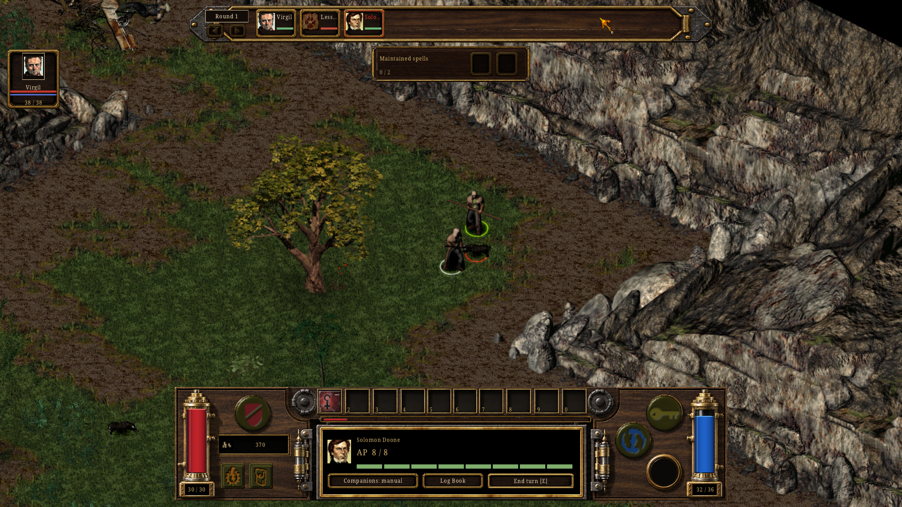
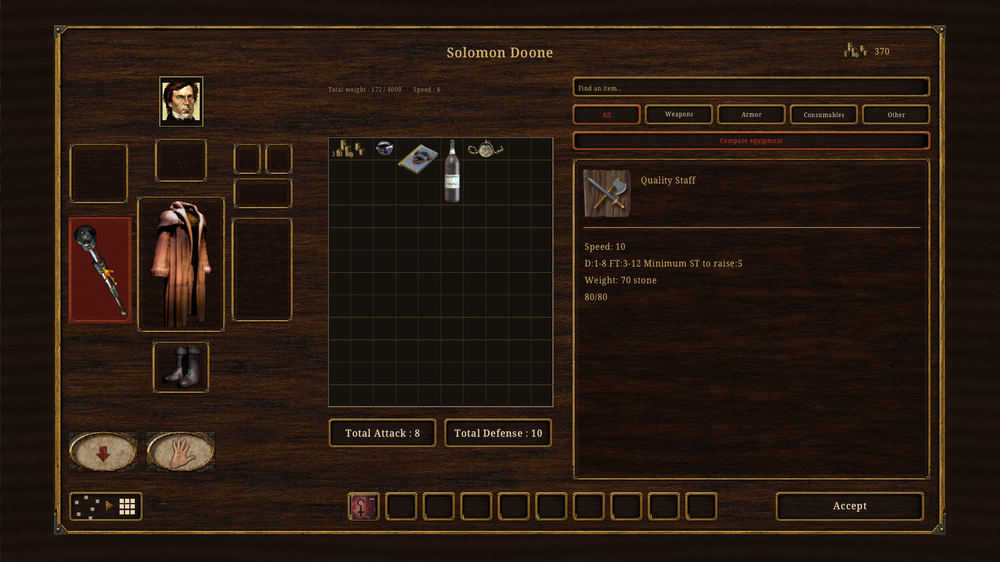
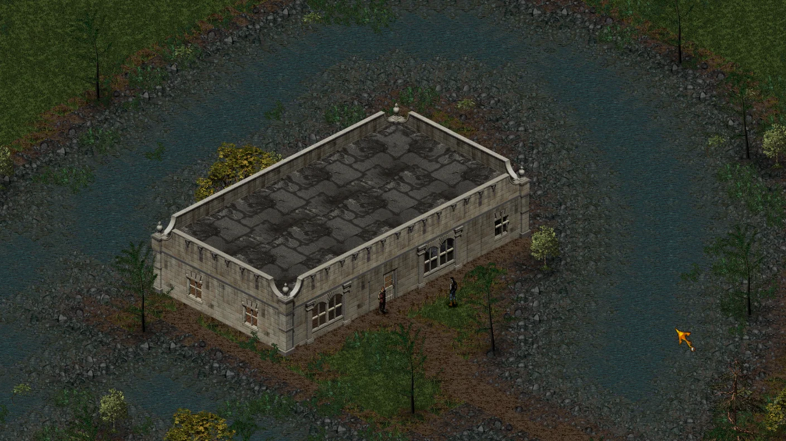
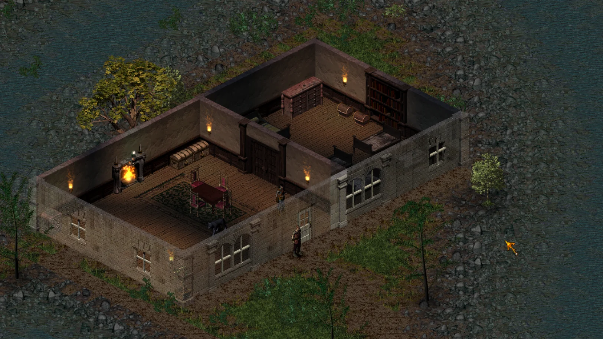

# Arcanum Renaissance

An unofficial interface and gameplay mod for **Arcanum: Of Steamworks and
Magick Obscura**, based on
[Arcanum Community Edition](https://github.com/alexbatalov/arcanum-ce).

## Windows Quick start

Download the [installer](https://github.com/cdomergue/arcanum-modern/releases/latest/download/ArcanumModern-windows-x64-setup.exe), select your Arcanum folder, and launch the game from the "Arcanum Renaissance" desktop shortcut. Check the Installation guide for more details and operating systems. Windows SmartScreen may warn that Arcanum Renaissance is from an unknown publisher because its executables are not yet digitally signed

## Features

- Floating HP feedback above actors: damage in red, healing in green. Numbers
  rise and fade out, including outside combat.

- Turn-based combat with direct companion control, switching between allies
  with consecutive turns, action previews and a scrollable combat log showing
  attack rolls, hit chances and outcomes. Walls fade around all combat
  participants throughout the fight, including between their turns. Combat uses
  Arcanum's rules.
- Redesigned HUD, character sheet, inventory, trading, dialogue, journal, maps,
  spell and skill panels, save/load menus and display options.
- Custom portraits imported during character creation or from your
  hero’s in-game character sheet, with cropping, zoom and automatic conversion
  to the classic game’s image formats.
- Custom backgrounds in character creation, with a name,
  personal history, attribute adjustments, native effects, starting money and equipment.
- Interactive voiced tutorial on a dedicated island, offered on first launch and
  replayable anytime from **Single Player → Tutorial** (with French or English
  subtitles).
- Zoom the world, pan with the keyboard, or use Follow Camera to move your character with WASD.
  Remap your keys and play in windowed, desktop fullscreen or exclusive fullscreen mode.
- Inventory search, categories, equipment comparison, item details, stack
  transfers and two banks of ten personal quick slots per controlled character.
- Integrated **AID descriptions in French and English** for the Arcanum
  campaign: item effects, strength requirements, quest and crafting tags,
  offerings and gifts. Supports existing saves and installations with AID
  already present. Magical properties remain hidden until identification.
- Independent companion positioning, regrouping and control outside combat.
  Your character and companions avoid detected ground traps and stop if no safe route is available.
- Select automatic level-up schemes for your character and companions.
  Choose None for a companion to assign their available points yourself.
- Equal combat XP for the hero and living companions at the end of each fight;
  progression beyond level 50.
- Five seconds of world-map travel between random encounters.
- Three rotating autosaves before and after combat and before eligible area
  transitions, separate from manual saves. Automatic saves can be disabled in the game options.
- Journal search, quest filters, favorites, quest tracking and personal map notes.
- Zoomable local maps with exploration fog, localized labels and route planning without a waypoint limit.
- Books, letters, newspapers, inscriptions, telegrams and floating dialogue
  using the installed game's text, plus playback of its original cinematics.
- Optional unlimited companions; disabled by default. Recruitment conditions apply.
- Various bug fixes not covered by UAP.

Game text follows the installed game's language. Additional interface text has
partial French and English support.

### Player housing

Edwin Harrow, in the office inside Tarant Town Hall, sells a furnished woodland house for 10,000
coins. The house is on the main map and supports storage in existing saves.
See [player housing](docs/housing.md) for the catalogue and content authoring.

### WorldED

WorldED is the English-language editor for sectors, buildings, objects, scripts
and dialogues. See [the editor guide](docs/worlded.md),
[Windows and Linux build instructions](docs/worlded-build.md), and
[the house authoring workflow](docs/housing.md#creating-a-house).
[Script Editor Renaissance](docs/script-editor.md) provides standalone script and
dialogue editing on Windows and Linux, with the same structured language and
native instruction editor used by WorldED.

## Installation

You need your own **Arcanum 1.0.7.4** installation. Downloads contain the mod;
original game files are required separately. Close the game before installing
or updating, and use a writable game folder.

Download the package for your platform from
[Releases](https://github.com/cdomergue/arcanum-modern/releases/latest).

| Platform | Install and launch |
| --- | --- |
| Windows x64 | Run [the setup](https://github.com/cdomergue/arcanum-modern/releases/latest/download/ArcanumModern-windows-x64-setup.exe) and select your Arcanum folder. Launch from the desktop or Start menu shortcut. For the ZIP, extract into the game folder and run **Play Arcanum Renaissance.bat**. |
| macOS | Requires Apple Silicon and macOS 11 or later. Extract the ZIP into the game folder and open **Arcanum Modern.app**. |
| Linux x64 | Extract the ZIP into the game folder and run **Play Arcanum Renaissance.sh**, or enter `./"Play Arcanum Renaissance.sh"` in a terminal there. |

Installation preserves the original executable, saved games and personal settings.
Back up your saves before changing engines or installing game patches.

### Updates

The Windows setup and all three platform ZIPs include the Renaissance launcher.
Desktop shortcuts, the macOS application and the Play scripts open it. It downloads
and installs newer stable releases before starting the game. Release notes are
displayed in a scrollable panel in their published language.

Choose **Play without updating** to use the installed version, or turn off
**Launch the game automatically** to keep reading. The launcher supports English
and French. An unavailable connection does not prevent playing. Updates preserve
saves, settings, custom portraits and backgrounds; failed installations are rolled
back. Opening the game executable directly also opens the launcher. The game
itself does not check for updates.

### Crash reports on Windows

Unhandled engine crashes create local reports in `ArcanumModern/CrashReports`
inside the game folder. If that location is not writable, reports go to
`%LOCALAPPDATA%/ArcanumRenaissance/CrashReports`. Keep the `.txt`, `.dmp` and
available `.manifest.json` files together when reporting a crash, and include
what you were doing. The minidump records thread stacks, registers and loaded
modules; it may contain fragments of process data. Nothing is uploaded
automatically. Forced termination, power loss and crashes before engine startup
may leave no report.

### Local maps

On first launch, Renaissance prepares detailed local maps from your game files.
Allow about **8 GB** for Arcanum and Vormantown, plus temporary working space.
Choose **Play now** to use the original maps; preparation resumes next launch.
Choose **Skip and don’t ask again** to disable automatic preparation.
Use **Options > Graphics > HD maps > Start generation** to resume manually.
Completed maps are reused.

If preparation fails, check `modern-ui/.map-work/generation.log` in the game
folder. **Play now** remains available.

### Unofficial Arcanum Patch (UAP)

- **French:** recognized original installations receive an optional launcher
  prompt to install **UAP 2.0.2 Base + Race Mod with hotfixes 1.1.0**. It downloads the patch,
  prepares French text and backs up saves before activation. Existing campaigns
  may be incompatible. See [installation and restoration](docs/uap-fr.md).
- **English:** eligible original installations receive the same optional offer
  for **UAP 2.0.2 Base + Race Mod with hotfixes 1.1.0**, using the original English text. An existing
  UAP installation is detected and kept. Manual installation remains available
  for additional components. See [installation and restoration](docs/uap.md).
- Recognized existing UAP 2.0.2 installations receive a separate optional offer
  for [Dergash’s UAP hotfixes](https://github.com/Dergash/arcanum-uap-hotfixes),
  with original English text or a French adaptation. Conflicting game data is
  kept unchanged; saves are backed up before activation.

## Controls

Change bindings in **Options → Key bindings**. AZERTY and QWERTY presets are
available. Original letter shortcuts are retained except A, S and W, which
share the movement keys: their actions use Shift + A, H and G respectively.
Existing custom bindings are preserved.

| Action | Default |
| --- | --- |
| Inventory / journal / character sheet | I / L / C |
| Map | G |
| Spells / skills / schematics | M / K / T |
| Rest | H |
| Stealth / pickpocket | Shift + H / P |
| Ready / unready weapons | R |
| Last active shortcut | Shift + A |
| Called shot: head / arms / legs (hold while attacking) | QWERTY key positions `,` / `.` / `/` (`;` / `:` / `!` on AZERTY) |
| End turn | E |
| Move character (follow camera) or pan (free camera) | WASD positions, ZQSD on AZERTY. Arrow keys also pan in free mode. |
| Zoom game view, travel map, local map or continent map | Mouse wheel over the world or map |
| Use quick slot | 1–0 |
| Close panel | Escape or Space |
| Open pause menu | Escape |

- **Quick slots:** hover an item, spell or skill and press **1–0**, or drag it
  onto the bar. Assignments are saved separately for each controlled character.
- **Inventory:** Shift-click transfers a whole stack. Middle-click runs the same
  arrangement as the sort button. Rebind **Sort inventory** to a keyboard key,
  middle click or Mouse 4/5 in **Options → Key bindings**; Backspace clears it.
  **Transfer all** moves bag contents to or from a companion or container,
  leaving equipped or immovable items.
- **Companions:** outside combat, click a portrait to select and detach a
  companion. Use the portrait's **`=` / `/`** control to toggle grouping.
  Click the portrait again, **Player**, or right-click the world to return to
  your main character. Right-click a familiar’s portrait to have it wait, follow again,
  or dismiss it permanently. Dismissal frees the slot for a new familiar.
- **Combat:** select an available ally in the initiative bar to act. Allies
  with consecutive turns can switch while they have action points. **End turn**
  finishes the selected character; enemies act after the group finishes.
  Left-click doors, containers and scenery to interact with them, including during combat.
  Hold **Alt** while clicking to attack them.
  Use **Companions: auto / manual** beside the combat log to let companions act automatically
  or take manual control again. Your character remains under manual control.
  Changes wait for the current companion action to finish and preserve remaining
  action points. The choice carries over to subsequent combats and is preserved
  in saves, including saves made outside combat.
- **Second hotbar:** hold **Shift** to display the second bank; release it to return
  to the first. **Shift + 1–0** activates its slots. Hold Shift when assigning
  items, spells or skills by number or drag-and-drop. Both banks are saved.
- **Maps and journal:** drag the map to pan. On travel and continent maps, the
  mouse wheel zooms in and out continuously, down to the full map. Travel
  destinations and route points follow the zoomed view.
  Set a route and use the travel
  button to follow it; the cancel control clears it. In the journal, the star
  marks favorites and the pin tracks a quest.

## Preferences and saves

Paths are relative to the game folder.

In **Options → Graphics**, set **Camera** to **Follow Camera** to keep your character centered as you move with the keyboard. Select **Free** to pan manually. During turn-based combat, the tactical camera follows the active turn.

In **Options → Graphics**, **Text size** adjusts interface text from 75% to
150%, including the HUD, dialogues, descriptions, journal and button labels.
The journal's **A− / A+** controls use the same setting. The choice is saved
automatically. Long labels wrap or show their full text on hover, and reading
panels adjust their line spacing and pagination. F9's original interface keeps
its native fonts.

| Path | Contents |
| --- | --- |
| `modern-ui/settings.ini` | Interface and gameplay preferences |
| `modern-ui/graphics.ini` | Display mode and resolution |
| `modern-ui/keys.ini` | Keyboard and inventory sorting bindings |
| `modern-ui/notebook-*.txt` | Favorites, tracked quests and map notes per character |
| `arcanum.cfg` | Engine and game settings |
| `modules/<module>/Save/` | Saved games |

Autosaves run when the game permits saving; dialogue, menus and some transitions
can defer or skip them. Notebook files are independent of saves: loading an
older save does not restore older notes. Keep both when moving an installation.

In **Options → Game**, **Companion auto-pickup** controls whether companions
spontaneously collect items and search junk piles. It is enabled by default;
turning it off preserves explicit pickup orders. This option applies in single
player and is saved between sessions.

## Compatibility

- This mod is compatible with original save files. It shouldn't break them if you switch back to the classic game either (except for discrepancies between UAP and non-UAP installs).
- The game uses its original sprites and terrain artwork.
- Do not apply the original High Resolution Patch to the Renaissance executable.
- AID descriptions cover the Arcanum campaign and UAP. Item rebalance mods may
  make their reference statistics inaccurate. Other campaigns use their installed
  descriptions. Quest tags remain after quest completion.
- Intel macOS, mobile platforms, multiplayer and engine patches beyond the
  documented UAP options are not validated.
- F9 switches between the modern and original interfaces outside tactical combat.

## Video

[Watch the presentation video](https://www.youtube.com/watch?v=aElikFnVZpw).

## Screenshots

| Tactical combat | Inventory |
| --- | --- |
|  |  |

| Woodland House — exterior | Woodland House — interior |
| --- | --- |
|  |  |

## Build and contribute

See the [development guide](docs/development.md#build-from-source) for build
requirements, platform commands, packaging and tests, and the
[repository guide](docs/repository.md) for the source layout. On Linux, `./build.sh`
compiles and installs the executable into `game/`. Supply your own game files
to run it.

## Credits and licenses

Arcanum was created by **Troika Games**. Renaissance is unofficial and includes
no original game data in its standard packages.

- **Arcanum Community Edition**, by **Alex Batalov and contributors**.
  Renaissance includes and modifies its engine source, based on
  [revision `a7ff41b300ef712f0e7d088183a3d08957110cdd`](https://github.com/alexbatalov/arcanum-ce/commit/a7ff41b300ef712f0e7d088183a3d08957110cdd).
  See the included [Sustainable Use License](source/LICENSE.md) and
  [engine provenance](source/README.md).
- **Arcanum Improved Descriptions (AID)**, by **SCARaw and contributors**, with
  a French translation for Renaissance:
  [original mod](https://www.nexusmods.com/arcanumofsteamworksandmagickobscura/mods/13),
  [source](https://github.com/SCARaw/Arcanum-Item-Description-Project),
  [MIT license](resources/aid/LICENSE.txt).
- **Noto fonts**: [SIL Open Font License](game/modern-ui/FONT-LICENSE.txt).
- **FFmpeg**: LGPL 2.1 or later. Runtime packages include license notices;
  matching dependency sources and build scripts are distributed as separate
  release assets. See [dependency source packages](docs/development.md).

Packages include license notices for SDL, SDL_mixer, zlib, fpattern, stb and
other bundled dependencies.

## Special thanks

Thanks to [OliverCooperMirror](https://github.com/OliverCooperMirror),
[Seldon24](https://www.reddit.com/user/Seldon24),
[LazarusHimself](https://www.reddit.com/user/LazarusHimself) and [SCARaw](https://www.reddit.com/user/SCARaw/) for helping find bugs
and suggesting new features.
